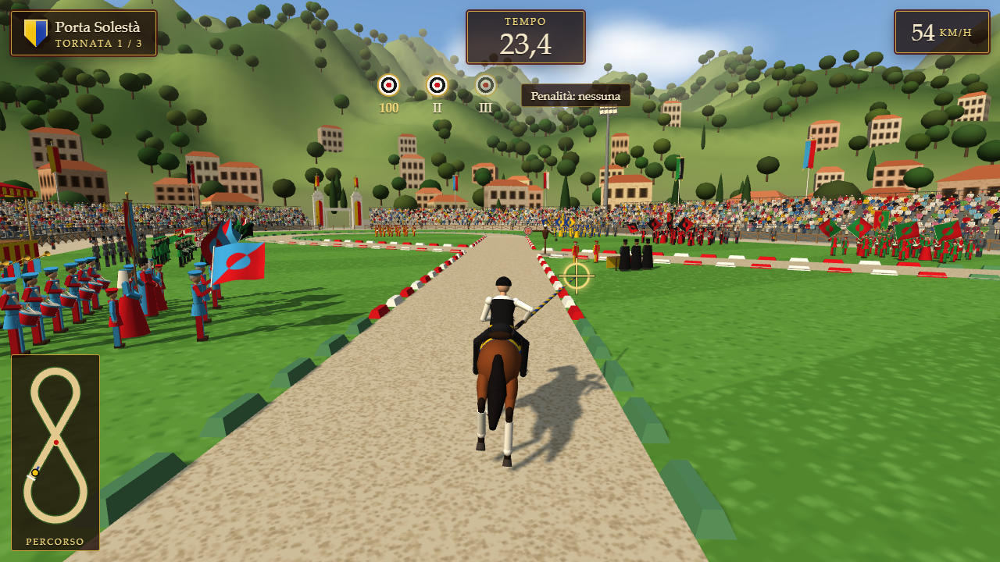

# Giostra della Quintana

Videogioco 3D puro frontend sulla Quintana di Ascoli Piceno. Sei il cavaliere di un sestiere al Campo dei Giochi "Squarcia".

**Gioca:** https://g95g95.github.io/giostra-quintana/

## Comandi

| Tasto | Azione |
|---|---|
| W / S oppure ↑ / ↓ | Accelera / frena |
| A / D oppure ← / → | Sterza |
| Mouse oppure I / K / J / L | Mira della lancia |
| Esc oppure P | Pausa |

## Regole

- 3 tornate, 3 assalti al Moro per tornata, percorso a otto di 720 m.
- Bersaglio: 100 / 80 / 60 / 40 / 20 punti.
- Tempo: 60,0 s = 200 punti, ±2 punti per decimo.
- Cordolo toccato: -30 punti. Uscita completa dalla corsia: tornata nulla.

## In locale

Apri `index.html` con un doppio clic. Non servono server, build o rete.

Test: `node --test tests/regole.test.js`

## Note

- Progetto amatoriale non ufficiale. Non è collegato all'Ente Quintana né al Comune di Ascoli Piceno.
- Grafica e audio sono procedurali. Il motore 3D è [Three.js](https://threejs.org/) r149 (licenza MIT), in `vendor/`.
